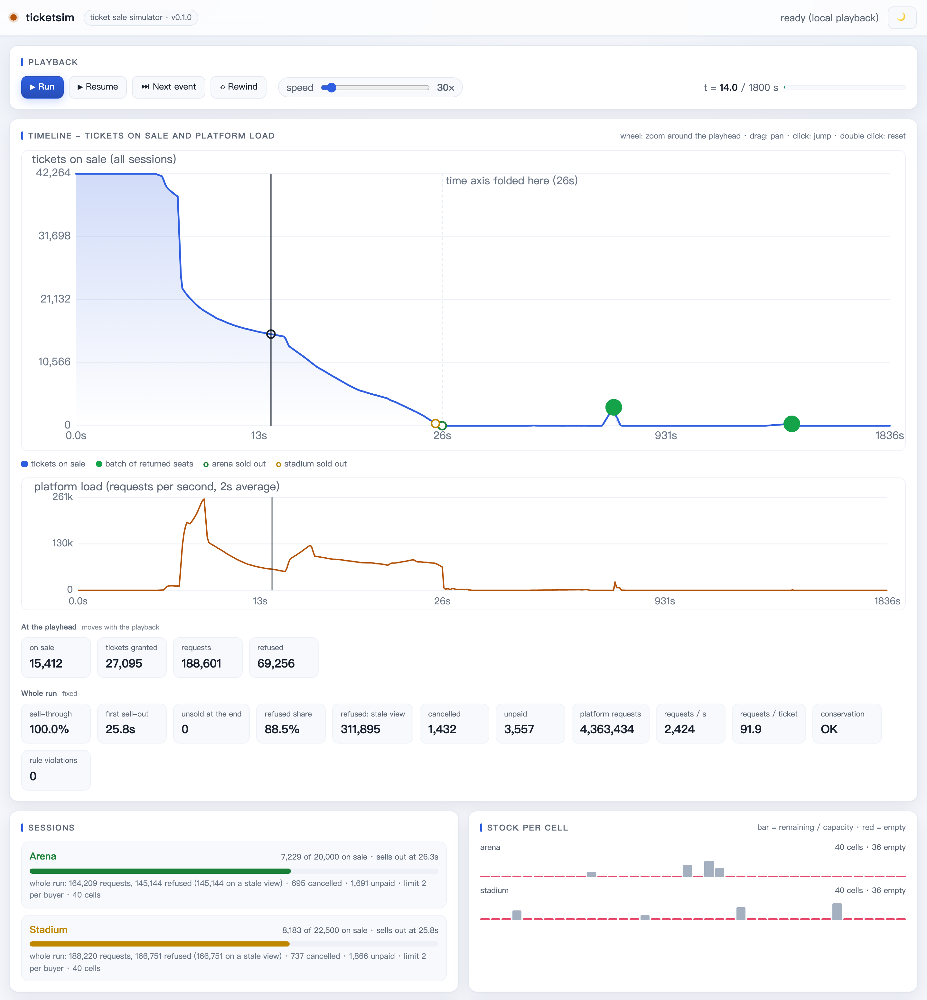
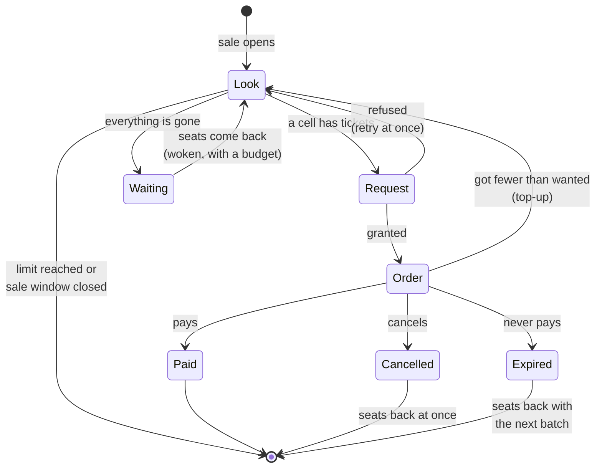
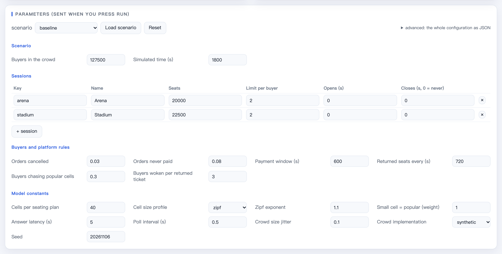
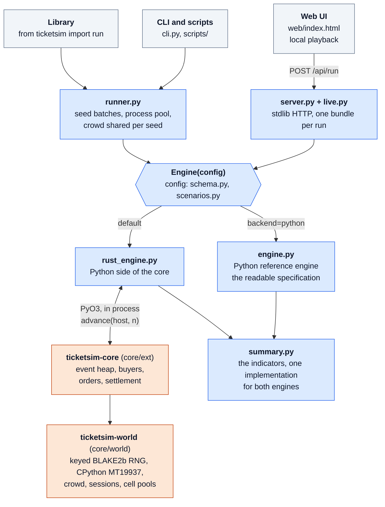
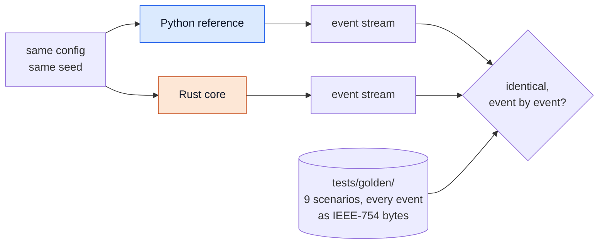

# ticketsim

[](https://github.com/jonathan-kao/ticketsim/actions/workflows/ci.yml)


[](LICENSE)

A discrete event simulator of a large ticket sale: a crowd of buyers arrives
the moment a sale opens and competes for the seats of a seating plan, while
cancellations and unpaid orders keep putting seats back on sale.

The research question is on the **platform's** side: how do the rules of a
sale - the purchase limit, the payment window, how often returned seats go
back on sale, how the seating plan is split - change how fast a sale sells
out, how many requests fail, and how much load the platform has to carry?

The engine runs a world of a million buyers in well under a second.  It has
two implementations: a readable Python reference and a Rust world core that
reproduces it bit for bit.

| At a glance | |
|---|---|
| **1,000,000 buyers** | simulated in 0.65 s on the Rust core, 17× faster than the Python reference |
| **Bit-identical engines** | Python and Rust agree event by event on 52 configurations |
| **Executable specification** | 9 golden event streams, checked byte for byte on both engines |
| **Paired experiments** | keyed randomness: two variants of a scenario see the same crowd |
| **Zero runtime dependencies** | standard library Python, one HTML file for the UI, no build step |

<picture>
  <source media="(prefers-color-scheme: dark)" srcset="docs/img/ui-overview-dark.png">
  
</picture>

## Highlights

- **A world of individual buyers.**  Every buyer has a speed, a desired
  quantity and a cell preference.  A request takes tickets from one cell of
  the seating plan, and it succeeds only if the cell still has them **when the
  platform answers**.  That gap is where most requests fail in a rush
  ([`docs/MODEL.md`](docs/MODEL.md)).
- **A dynamic stock.**  Orders are paid, cancelled (seats back at once) or
  never paid (seats back in periodic batches).  Waiting buyers are woken when
  seats come back, with a budget per returned ticket.
- **Bit-identical Rust core.**  The event loop, the crowd and the ticket pool
  are ported to Rust behind an in-process PyO3 boundary.  Every run is
  compared with the Python reference **event by event**, including Mersenne
  Twister state, `random.gauss` caching, libm calls and Python's rounding
  rules ([`docs/ENGINEERING.md`](docs/ENGINEERING.md)).
- **An executable specification.**  Golden fixtures store the complete event
  stream of nine scenarios as language-independent bytes.  A refactoring is
  done when they still match.
- **Paired comparisons.**  Randomness is keyed by entity (buyer, order,
  attempt), not by draw order, so two variants of a scenario see the same
  crowd.  The difference between two rows of a report is the effect of the
  rule that changed.
- **A web UI** that runs a scenario once and plays it back locally: tickets on
  sale over time, the platform load, the stock of every cell, per-session
  statistics and every parameter.

## Quick start

The Rust toolchain is installed **inside this folder** by
[mise](https://mise.jdx.dev); nothing is written to `~/.rustup` or `~/.cargo`.

```sh
mise trust && mise install     # once: the pinned Rust toolchain
mise run build                 # build ticketsim/ticketsim_core.abi3.so
mise run test                  # Rust unit tests + the Python suite + the golden check
```

Without Rust, everything runs on the Python reference engine (about 15 times
slower, same numbers):

```sh
export TICKETSIM_BACKEND=python
```

Run something (Python 3.9 or newer, no third-party packages):

```sh
python3 scripts/serve_ui.py                          # the web UI on :8000
python3 -m ticketsim scenarios                       # the scenarios
python3 -m ticketsim run --preset baseline           # one run, summary in the terminal
python3 -m ticketsim batch --presets baseline,limit_4,cells_200 --seeds 0-9
python3 -m ticketsim visualize --preset baseline     # a self-contained HTML report
python3 scripts/run_experiments.py --seeds 0-9       # results/REPORT.md
python3 scripts/sensitivity.py > results/SENSITIVITY.md
```

As a library:

```python
from ticketsim import build, run

result = run(build("baseline").with_behavior(payment_window=300.0))
print(result.summary["sell_through"], result.summary["buyer_failure_rate"])
```

## The model in one picture

Every buyer runs through the same loop.  The decisive gap is between
**looking** and **the answer**: the buyer chooses on what the page showed, the
platform decides on what the cell holds `delay + poll_seconds` later.



The rules behind every arrow, with the code that implements them, are in
[`docs/MODEL.md`](docs/MODEL.md).

## The web UI

`python3 scripts/serve_ui.py` starts the backend and opens the page.  Press
**Run**: the backend simulates the whole scenario once (well under a second)
and sends back one bundle; the browser then plays it back locally, so
playing, pausing, seeking and zooming never wait for the network.  The
screenshot above is the baseline scenario 14 simulated seconds into the sale.

| Part | What it shows |
|---|---|
| **Playback** | run, pause / resume, jump to the next marked moment (a sell-out or a batch of returned seats), rewind, playback speed, the simulated clock |
| **Tickets on sale** | the stock of all sessions over time.  The time axis is folded at the first sell-out: the rush of the first seconds gets the left half, the long tail of returned seats the right half.  Green dots are batches of returned seats, rings mark when each session sold out.  Wheel zooms around the playhead, drag pans, click jumps, double click resets |
| **Platform load** | requests per second (inventory reads, submits, polls and checkouts, averaged over 2 s) on the same time axis |
| **At the playhead** | stock, tickets granted, requests and refusals up to the current moment; they follow the playback |
| **Whole run** | the indicators of the finished run: sell-through, first sell-out, refused share and how much of it came from a stale view, returned seats, total load, and the self checks (conservation, rule violations) |
| **Sessions** | each session's remaining stock and sell-out time, with its request and refusal counts |
| **Stock per cell** | one bar per cell of the seating plan, height = remaining / capacity, red = empty.  Here 36 of 40 cells are already empty while a few large cells still hold most of the stock |

Below the charts sits every parameter of the run, grouped as in
[`docs/PARAMETERS.md`](docs/PARAMETERS.md): pick a named scenario, change any
field or add sessions, and press Run again.  The whole configuration can also
be edited as JSON.



## What the model says

From [`results/REPORT.md`](results/REPORT.md) (10 seeds per scenario) and
[`results/SENSITIVITY.md`](results/SENSITIVITY.md).  All parameters are
synthetic; the point is the mechanisms, not the absolute numbers.

- **Most requests fail, and they fail on a stale view.**  In the baseline
  (a crowd three times the stock) about 89 % of all purchase requests are
  refused, and nearly all of those because the cell had sold out between the
  buyer's look and the platform's answer.
- **The seating plan is the biggest lever on the load.**  One single cell
  sells out in 7.5 s with 1.9 M requests; 200 small cells take 31 s and 8.3 M
  requests, because every small cell runs dry on its own and the buyers aimed
  at it all fail.
- **Everybody chasing the same seats is the worst case.**  When every buyer
  goes for the most popular cell first, the first sell-out comes twelve times
  later and the load grows eightfold.
- **The answer latency multiplies the load.**  A platform that answers in 20 s
  instead of 5 s sees five times the traffic, and half again as many requests
  fail on a stale view.
- **Returned seats cost far more than they are worth.**  With 10 % of the
  orders cancelled instead of 3 %, the load grows by 43 %: every returned seat
  wakes a group of waiting buyers, and only one of them gets it.

## Architecture



Blue is Python, orange is Rust.  The Rust core owns the hot loop (the event
heap, the crowd and the ticket pools); configuration, orchestration and the
indicators stay in Python, so the counting rules exist once and cannot drift
apart between the two engines.

| Path | What |
|---|---|
| `ticketsim/` | the package: model, engines, runner, CLI, report, web UI |
| `core/` | the Rust world core (a Cargo workspace of two crates) |
| `tests/` | the test suite; `tests/golden/` holds the executable specification |
| `scripts/` | build the core, write the golden fixtures, the report and the sensitivity scan, start the UI |
| `results/` | the generated report and sensitivity scan |
| `docs/` | [`MODEL.md`](docs/MODEL.md) (the rules of the world), [`ENGINEERING.md`](docs/ENGINEERING.md) (how it is built and why), [`PARAMETERS.md`](docs/PARAMETERS.md) (every parameter) |

## Validation

The Python engine is the specification; the Rust core has to reproduce it
exactly, not approximately:



| What | Where |
|---|---|
| Rust core against the Python reference, event by event, over 52 configurations | `tests/test_backends.py` |
| The executable specification: nine scenarios, byte for byte, on both engines | `tests/golden/`, `scripts/make_golden.py --check` |
| The aggregated order flow against a naive agent-per-buyer simulation | `tests/test_equivalence.py` |
| The two crowd implementations (parallel arrays vs one object per buyer) | `tests/test_crowd.py` |
| Conservation (`capacity = on sale + pending + paid`, per cell), limits, accounting | `tests/test_invariants.py`, `tests/test_cells.py`, `tests/test_settlement.py` |
| Performance bounds | `tests/test_perf.py` |
| The docs only mention parameters and indicators that exist | `tests/test_docs.py` |
| The web UI (DOM stub, no browser needed) | `node tests/ui_harness.js 8000` with the UI running |

## Performance

Best of three runs on an Apple laptop (M-series), two sessions with 42,500 seats in total:

| Buyers | Rust core | Python reference |
|---:|---:|---:|
| 20,000 | 0.05 s | 0.52 s |
| 100,000 | 0.15 s | 1.90 s |
| 1,000,000 | 0.65 s | 10.8 s |

The whole report (13 scenarios × 10 seeds) takes about 4 s on 10 cores.

## License

[MIT](LICENSE)
